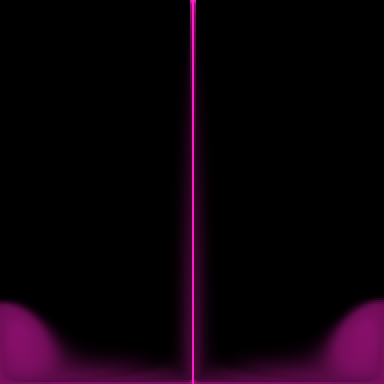

# Mantaflow-Lite

Solver de fluidos 2D autocontenido con **tres backends intercambiables desde la
CLI**: memoria de verdad depende de cuánto quieras pagar por ella.

```
python -m mantaflow_lite --backend cpu    # numba paralelo + Gradiente Conjugado (exacto)
python -m mantaflow_lite --backend tricks # trucos de videojuego: Jacobi fijo + media resolución
python -m mantaflow_lite --backend gpu    # PyTorch/CUDA, solver jacobi o cg
```


*Vertido fluorescente 192² con `gpu --solver cg`; este es el estado estacionario
del chorro + splash (pasos 0–320). Frame final a paso 400:*



### Escena 2: lluvia sobre una esfera invisible

```bash
python -m mantaflow_lite --backend gpu --solver jacobi --jacobi-iters 16 --scene rain \
  --res 512 --steps 900 --save-every 3 --rain-every 3 --rain-drops 4 \
  --pour-width 2 --pour-speed 16 --obstacle-y 0.67 --gravity 12
```

Gotas **aleatorias escalonadas** (cada ranura de gota tiene su propia fase: no
hay ráfagas sincronadas) caen en una banda alrededor de la esfera
(`--rain-spread`, por defecto 2× radio), y ~40% de las gotas nace **debajo de
la esfera**: son las que "pasaron por detrás" — al caer cierran su arco
inferior, así la esfera se lee como volumen con profundidad y no como una
columna. La esfera no se dibuja: su contorno aparece porque el líquido se
acumula y desliza sobre una máscara de celdas sólidas que **enmascara el
Laplaciano** (cara cerrada = vecino excluido de la diagonal y del spmv), el
gradiente (sin corrección a través del sólido) y la densidad (0 dentro). La
lluvia es determinista (`rain_seed`): los tres backends ven exactamente las
mismas gotas, así la paridad se mantiene.


Clip completo de la misma escena a 1024×1024 (300 frames @ 30 fps, backend GPU
+ Jacobi-16, 900 pasos): **[media/rain_sphere_1024.mp4](media/rain_sphere_1024.mp4)**
— gotas cayendo alrededor de la esfera, el contorno cerrándose con la lluvia
trasera y la inundación final con la silueta completa revelada.

## Por qué existe este proyecto

Se analizó [Mantaflow](https://github.com/tum-pbs/mantaflow) (Apache 2.0) como
referencia: su diseño es impecable — grids densos `T* mData`, preprocessor
`KERNEL` que genera código OMP/TBB, y un CG con precondicionador mIC — pero es
un proyecto C++ grande con `cmake`+`nvcc` que no corre en cualquier máquina.
Además, **no existe un port GPU (CUDA/OpenCL/Vulkan) de Mantaflow**: Blender
sigue esperando aceleración de FLIP (issue
[#163996](https://projects.blender.org/blender/blender/issues/163996)), NVIDIA
Flow es de licencia no-OSI, y no aparece nada con licencia abierta que ocupe ese
hueco.

Mantaflow-Lite es el hueco en miniatura: mismo planteamiento numérico
(MAC + semi-Lagrangian + proyección de presión), en Python puro, con las tres
filosofías de costo que existen en la práctica:

| backend | qué hace | contrato |
|---------|----------|----------|
| `cpu` | numba `prange` + **Gradiente Conjugado** (float64, `cg_tol=1e-3`) | calidad de referencia |
| `tricks` | resolución completa con **iteraciones fijas** de Jacobi; la presión se resuelve a **media resolución** (bilineal + pulido) | presupuesto de trabajo constante, ~10× más barato |
| `gpu` | PyTorch/CUDA en float32; `--solver jacobi` (idéntico a `tricks`) o `--solver cg` (idéntico a `cpu`) | mismo algoritmo, otro hardware |

La idea de "tricks" es la receta clásica de videojuego: nunca iterar hasta
converger — iterar siempre lo mismo, resolver grueso y refinar barato.

## Matemáticas (y por qué los tests pasan)

- **MAC staggered**: `u (r, r+1)` en caras verticales, `v (r+1, r)` en caras
  horizontales, densidad `d (r, r)` en centros. Paredes: `u[:,0]=u[:,-1]=0`,
  `v[0,:]=v[-1,:]=0`.
- **Advección semi-Lagrangian** con muestreo bilineal (incondicionalmente
  estable; difusivo con CFL altos — honestidad abajo).
- **Proyección**: `div = Δu + Δv`, sistema `A p = -div` con `A = diag − vecinos`
  (Neumann: vecinos faltantes excluidos del diag), gradiente:
  `u -= Δp`, `v -= Δp`.
- La gravedad empuja la densidad; el vertido inyecta `d=1` y velocidad en la
  fila techo. En espacio-matemático la fila 0 es el piso; el render la voltea.

## Instalar y correr

Requisitos: Python ≥ 3.10, `numpy`, `numba`, `pillow` (+ `torch` con CUDA para
el backend GPU). Con `pytest` para los tests.

```bash
python -m mantaflow_lite --backend tricks --res 256 --steps 300 --save-every 20
python -m mantaflow_lite --backend gpu --solver cg --res 512 --steps 400
python bench.py 128 256 512        # reproduce la tabla de abajo
pytest tests -q                    # 12 tests
```

Flags: `--res` (par), `--steps`, `--dt`, `--gravity`, `--pour-x`, `--pour-width`,
`--pour-speed`, `--scene default|rain` (escena de lluvia con esfera invisible),
`--obstacle-x/y/radius`, `--rain-every/drops/seed`, `--jacobi-iters`,
`--polish-iters`, `--no-half-res`, `--cg-tol`, `--out`, `--save-every`.

## Rendimiento (medido, no estimado)

Máquina: Xeon E5-2620 v3 (6C/12T) + GTX 1650, Python 3.11, torch 2.12+cu126.
`ms/paso` con JIT calentado (warmup 3, promedio 8 pasos):

| res | cpu | tricks | gpu jacobi | gpu cg |
|-----|-----|--------|------------|--------|
| 128² | 60.50 | **4.33** | 14.83 | 62.27 |
| 256² | 127.03 | **13.38** | 15.08 | 62.99 |
| 512² | 861.09 | **65.18** | **15.19** | 79.41 |

Lectura honesta:

- `tricks` es **9–14× más barato que `cpu`** a cualquier resolución con la misma
  calidad "suficiente" (abajo).
- `gpu jacobi` gana claro a partir de 256² (57× a 512²); a 128² el *kernel launch
  overhead* de CUDA lo hace **más lento** que la CPU — decir lo contrario sería
  mentir.
- `gpu cg` escala bien (11× a 512²) y entrega la solución exacta; a 128² la CPU
  numba le gana por poco.

## Calidad (divergencia pre → post proyección)

| backend | pre (max\|div\|) | post | factor |
|---------|------------------|------|--------|
| `cpu` (CG) | 2.7145 | 0.00035 | ~7700× |
| `gpu cg` | 2.7145 | 0.00035 | ~7700× |
| `tricks` / `gpu jacobi` | 3.6780 | 0.29270 | ~12× por paso (estado estacionario) |

El CG converge; el Jacobi fijo no — ese es el trato. En práctica la
advección semi-Lagrangian amortigua el error residual, y el precio se paga en
velocidad, no en colapso numérico.

## Tests (16, todos en verde)

```bash
pytest tests -q
```

- **Estabilidad**: 20 pasos sin NaN, densidad acotada en [0,1], masa depositada.
- **Proyección**: `cpu` reduce la divergencia >100×; `tricks`/`gpu` >2× por paso.
- **Paridad** (la validación fuerte): mismo algoritmo ⇒ mismos resultados.
  `cpu-cg` vs `gpu-cg` y `tricks` vs `gpu-jacobi` coinciden en diferencias
  medias < 0.03 en bloques de salida — si un backend se desvía del otro, el
  test revienta.
- **Presupuesto**: `tricks` efectivamente más rápido que `cpu` en escena real.
- **Escena lluvia+esfera** (por backend): nada de densidad dentro del sólido,
  líquido llegando al contorno, NaN fuera, y lluvia idéntica entre backends.
- Render: PNG con la geometría esperada.

## Límites (sabidos, no escondidos)

- Solo 2D; una sola fase con umbral de densidad. No es FLIP/PIC: es Eulerian
  puro, así que la difusión numérica existe (con `dt` grande el chorro se
  "perla"; se ve en runs largos por encima de ~400 pasos con los defaults).
- El Jacobi de `tricks` deja ~0.3 de divergencia residual: bien para juego,
  no para paper.
- En 128² la GPU no ayuda. El solver CG de `cpu` usa float64 y está limitado
  por `cg_max_iter=400` en escenas duras.
- El "port de Mantaflow" es conceptual: reescribimos la receta numérica en
  Python, no compilamos su C++.

## Estructura

```
mantaflow_lite/
  sim.py            # SimConfig + create_backend + escenas (build_fluid, rain_spots)
  cli.py, __main__.py
  render.py         # densidad -> magenta fluorescente (PNG/GIF)
  backends/
    cpu.py          # kernels numba compartidos + CG float64
    tricks.py       # Jacobi fijo + media resolución (numpy float32)
    gpu.py          # torch/CUDA float32 (jacobi | cg)
tests/test_backends.py
bench.py
```

## Roadmap

- [ ] Advección BFECC/MacCormack para reducir difusión
- [ ] Solver multigrid V-ciclo (reemplazaría el truco de media resolución por algo con convergencia)
- [ ] Vorticity confinement (el penacho se notaría con más vida)
- [ ] Soporte `half_res=False` completo para `gpu` (ya existe el flag)
- [ ] Export GIF desde la CLI

## Licencia

MIT. Inspirado conceptualmente en
[Mantaflow](https://github.com/tum-pbs/mantaflow) (Apache 2.0) — su diseño de
grids y su CG fueron la referencia de esta reescritura; no contiene su código.
